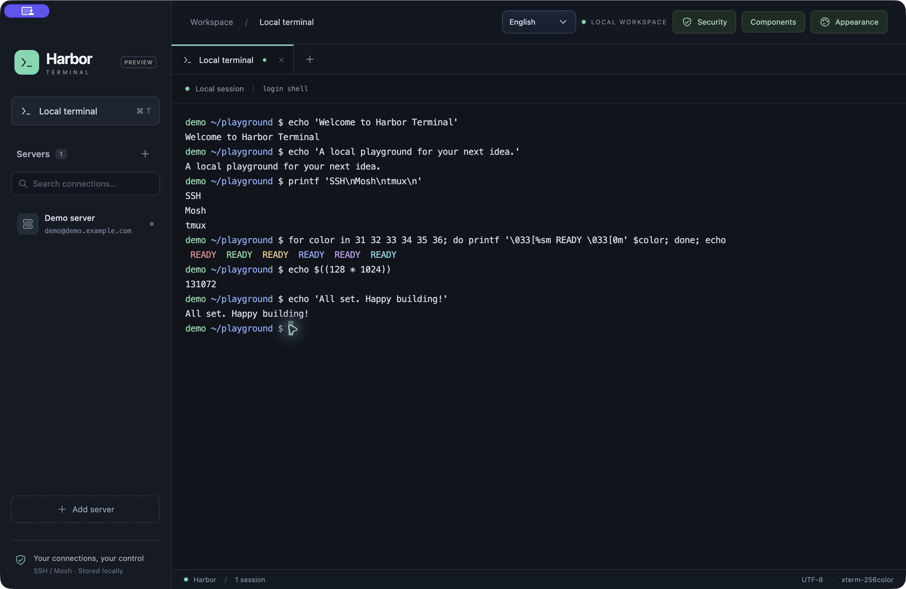

<div align="center">
    <h1>⚓ Harbor Terminal — SSH Client &amp; Terminal Emulator</h1>
    <h3><em>Tabbed SSH and Mosh sessions for macOS, Windows and Linux</em></h3>
</div>

<p align="center">
    <strong>Harbor Terminal is an open-source SSH client and terminal emulator that brings local shells and remote servers into one workspace. It combines saved SSH connections, independent terminal tabs, automatic reconnect, optional Mosh, encrypted server settings and customizable themes—with instant Chinese / English switching.</strong>
</p>

<p align="center">
    <a href="https://github.com/0xfnzero/harbor-terminal/releases">
        
    </a>
    <a href="#documentation">
        
    </a>
    <a href="LICENSE">
        
    </a>
    <a href="https://github.com/0xfnzero/harbor-terminal/stargazers">
        
    </a>
    
    
</p>

<p align="center">
    
    
    
</p>

<p align="center">
    <a href="README_CN.md">中文</a> |
    <a href="README.md">English</a> |
    <a href="https://github.com/0xfnzero/harbor-terminal/releases">Releases</a> |
    <a href="https://fnzero.dev/">Website</a> |
    <a href="https://t.me/fnzero_group">Telegram</a> |
    <a href="https://discord.gg/vuazbGkqQE">Discord</a>
</p>

Current version: **0.1.4 Preview**. macOS has been tested locally. Windows/Linux adapters and local build commands are included, but native acceptance remains pending. This project is a desktop app, not a published npm package.



## Contents

- [Installation](#installation)
- [Features](#features)
- [Usage examples](#usage)
- [Connection and recovery notes](#connections)
- [Security and encryption](#security)
- [Documentation](#documentation)
- [Project structure](#project-structure)
- [Testing and builds](#testing)
- [Important notes](#important-notes)
- [License](#license)
- [Contact](#contact)

<a id="installation"></a>

## Installation

### Download the desktop app

Download Harbor Terminal from [GitHub Releases](https://github.com/0xfnzero/harbor-terminal/releases). The initial release includes a macOS Apple Silicon preview; each release lists available platforms, checksums and known limitations.

### Run from source

Use Node.js **22.12+ or 24+**, npm and your operating system's OpenSSH client. Clone the repository and run:

```sh
git clone https://github.com/0xfnzero/harbor-terminal.git
cd harbor-terminal
npm ci
npm run dev
```

To build the renderer and launch the desktop app:

```sh
npm start
```

Mosh is optional. Persistent remote sessions require **tmux on the server**; disable Persistent session for a regular SSH shell. On Windows, local shells and the optional WSL runtime stay inside Harbor's UI.

<a id="features"></a>

## Features

1. **Saved servers**: Name your SSH connections and open each in an independent tab.
2. **Flexible authentication**: Local SSH config / agent, PEM private keys, encrypted-key passphrases, passwords, keyboard-interactive / OTP and SSH certificates.
3. **Connection recovery**: Keepalives, bounded retry backoff, countdown, pause and manual reconnect; tmux preserves remote tasks.
4. **Optional Mosh**: Adaptive predictive echo and protocol-level network recovery on a configurable UDP port.
5. **Integrated component setup**: Install Mosh inside the app, optionally using an authorized server admin account and adding the configured firewall rule.
6. **Encrypted settings**: Optional app lock password and macOS Touch ID, AES-256-GCM storage, fresh memory keys after unlock and independent per-tab reconnect keys.
7. **Instant bilingual UI**: Switch 中文 / English in the toolbar or lock screen. The choice persists after restart without reopening terminals.
8. **Appearance presets**: Harbor, Tokyo Night, Dracula, Nord, Daylight and Amber; customize fonts, spacing, cursors, the ANSI palette and up to 12 saved themes.
9. **Terminal performance**: Native PTYs, xterm.js, WebGL for the active tab, batched output and bounded buffering.

<a id="usage"></a>

## Usage examples

### 📋 Connect to a server

1. Click **Add server** and enter a name, host, username and SSH port.
2. Use **Authentication** to select local keys, a PEM file, key + password, or password login. Passwords and key passphrases are entered during connection and are not saved.
3. Adjust **Network & session**, then click **Save connection**.
4. Click the saved server to open a terminal tab. Each click creates a separate connection.

For AWS, choose the downloaded `.pem` under **Private key / PEM file**. A CA-signed SSH certificate is a separate optional file; a normal `.pub` file cannot replace your private key. The server decides whether a second authentication factor is required.

### 🌐 Switch languages

Use **Language / 语言** in the top toolbar or on the lock screen and choose **中文** or **English**. The interface, native application menu and app-generated messages use the selected language. Server names, custom theme names, commands and remote output remain exactly as entered or received.

The preference is stored in `preferences.json` under Electron's user-data directory. It contains only the interface language and remains available while the server vault is locked. English is the default when no preference is saved. A manually selected language is retained across restarts.

### 🎨 Customize appearance

Open **Appearance**, select a preset and adjust font, font size, line height, letter spacing, cursor and colors. **Apply & save** updates existing terminals without recreating their PTYs. Fonts must already be installed locally; missing fonts use a monospace fallback. Command highlighting follows ANSI output; shell syntax highlighting is configured by the shell itself.

### ⌨️ Keyboard shortcuts

- macOS: `⌘T` opens a local terminal; `⌘W` closes the current tab.
- Windows/Linux: `Ctrl+Shift+T` opens a local terminal; `Ctrl+Shift+W` closes the current tab.
- Dropdowns support arrow keys, Home/End, Enter and Escape.

### Terminal colors and controls

New local tabs enable shell styling by default; turn it off in Appearance. zsh/bash use blue directories, cyan links and green executables. GNU ls also distinguishes archive and image extensions; macOS ls colors by file type. zsh includes BSD-3-Clause licensed zsh-syntax-highlighting 0.8.0 and preserves an already-loaded user plugin; PowerShell uses PSReadLine when available. ANSI colors follow the selected terminal theme without rewriting arbitrary command output. Styling replaces the local prompt but never edits user shell configuration files; disable it if you prefer your own prompt framework. Remote shells retain their server configuration.

- Copy / paste: macOS `Cmd+C` / `Cmd+V`; Windows/Linux `Ctrl+Shift+C` / `Ctrl+Shift+V`; `Shift+Insert` also pastes.
- `Ctrl+C` still interrupts commands. Right-click for copy, paste, select all, search, clear scrollback and scroll to bottom.
- Search: `Cmd+F` / `Ctrl+Shift+F`; Enter for next, Shift+Enter for previous, Escape to close.
- Select the terminal buffer: `Cmd+A` / `Ctrl+Shift+A`; clear scrollback: `Cmd+K` / `Ctrl+Shift+K` (does not stop remote tasks).
- Multiline paste requires confirmation and uses xterm's bracketed paste support; this is not a command sandbox.
- Command/Ctrl-click HTTP(S) links to open them in your default browser.
- `make test-terminal` checks clipboard, context menus, search and interrupt keys.

### Input and clipboard protection

Configure this under **Security → Input & clipboard protection**. On macOS, Secure Keyboard Entry is enabled while Harbor has focus and released on blur or exit. Windows/Linux do not provide this macOS mechanism. It may affect global shortcuts or accessibility tools and can be disabled.

Copy and paste use the normal system clipboard and interoperate with other apps. Harbor adds ownership markers and platform-specific history/sync exclusion hints. Compatible clipboard managers may honor these hints; they are not access controls. Optional expiry is 30/60/120 seconds, with timed clearing disabled by default. On lock or normal exit, Harbor attempts to clear only clipboard data that still carries its ownership marker, preserving later copies from other apps. Cleanup is best-effort and cannot retract text already read or recorded elsewhere.

**This does not guarantee protection against malware.** The system clipboard is shared, and keyboard protection cannot defeat a compromised OS/process, injection or screen capture. Temporary plaintext used for input, paste previews and IPC cannot be guaranteed to be immediately erased from JavaScript memory.

<a id="connections"></a>

## Connection and recovery notes

### 🔄 SSH and tmux

SSH retries abnormal transport/authentication exits with delays of 1, 2, 4, 8, 16 and then 30 seconds. Balanced, unstable-network and fast-recovery profiles adjust keepalive detection and connection timeouts. Detection times are approximate; authentication may require user input after reconnect.

The same tab reuses its remote tmux session identifier. Closing a tab detaches its client; persistent remote tasks continue. Clicking a server again or restarting Harbor creates a new tab/session; attach older tmux sessions manually when needed. Server restarts or terminated remote tasks cannot be recovered by reconnecting alone.

### 📡 Mosh components and ports

Mosh authenticates over SSH, then uses UDP. The default server port is **60042**, editable in the connection settings. Each simultaneous Mosh connection needs a separate UDP port; configure a range of up to 64 ports for concurrent tabs on the same server.

**Components** can install the local client or server component. Automatic installation supports Homebrew on macOS and Debian/Ubuntu user-directory packages; an authorized root account can install shared server packages. Windows runtime setup uses PowerShell/WSL internally and may require UAC or a reboot.

Optional firewall setup adds only the configured UDP port/range through UFW or firewalld. It does not toggle the entire firewall or edit cloud security groups. Old rules are not automatically removed. Mosh prediction improves perceived typing latency, not network RTT or command execution speed. If UDP is unavailable, **Use SSH instead** opens a regular SSH tab.

<a id="security"></a>

## Security and encryption

Open **Security** to enable an independent Harbor lock password (at least 12 characters) and optionally macOS Touch ID. No encrypted storage is claimed before enabling this feature.

- **Disk**: Server names, hosts, usernames, key paths and connection settings are encrypted with AES-256-GCM. A random data key is protected by a password-derived scrypt key (`N=131072, r=8, p=1`, random salt).
- **Unlocked configuration**: Each unlock generates a fresh random memory key. Configuration reads use encrypted memory caches; the disk key is only briefly available during unlock or saving.
- **Existing sessions**: Each tab has an independent encrypted connection snapshot and random session key. Locking blocks configuration access, new connections and terminal input, while existing sessions can continue and reconnect. Closing the tab clears its session key.
- **Touch ID**: macOS performs fingerprint verification, followed by system-protected key access through Electron safeStorage. Harbor does not collect fingerprint data. Windows Hello / Linux biometrics are not implemented.
- **Auto-lock**: Defaults to 30 minutes of inactivity; also locks on system lock, sleep or closing the app window. Authentication is reused across servers while unlocked.

External PEM files are not imported or re-encrypted. Passwords, OTPs and private-key passphrases are not saved. Displayed text, terminal buffers, running SSH/Mosh processes and transient decrypted values cannot remain ciphertext at every instant. Background reconnect requires session keys in memory even while locked; this does not protect against an attacker with full access to the running process. Preserve your password: without it or working Touch ID, the encrypted vault cannot be recovered.

<a id="documentation"></a>

## Documentation

- [English README](README.md)
- [中文 README](README_CN.md)
- [Development, architecture and validation notes (Chinese)](docs/DEVELOPMENT_CN.md)
- [v0.1.4 release notes](docs/releases/v0.1.4.md)
- [Shared UI and backend translations](shared/messages.json)

<a id="project-structure"></a>

## Project structure

```text
terminal/
├── electron/        # PTY, SSH/Mosh, vault, installers, native menu and IPC
├── src/             # React UI, terminal tabs, dialogs, themes and language switching
├── shared/          # Theme presets and Chinese/English message catalog
├── test/            # Protocol, encryption and desktop UI regression tests
├── docs/            # Architecture and validation records
├── README.md        # English guide
└── README_CN.md     # Chinese guide
```

<a id="testing"></a>

## 🧪 Testing and builds

Install Node.js, npm and GNU Make, then run `make` or `make help` to list every command and description. On Windows, use GNU Make (for example from MSYS2) with Windows Node.js. Build Windows installers in a native Windows environment, not inside WSL Linux.

```sh
make                       # List commands and descriptions
make install               # Install locked dependencies
make dev                   # Development app with hot reload
make start                 # Build and launch the desktop app
make build                 # Build only the renderer
make test-all              # Run all tests sequentially
make pack                  # Package for the current OS and architecture
make pack-mac ARCH=arm64    # macOS DMG + ZIP
make pack-mac ARCH=x64      # Intel macOS DMG + ZIP
make pack-win ARCH=x64      # Windows NSIS + portable EXE
make pack-linux ARCH=x64    # Linux AppImage + deb
make pack OUT=release/demo # Choose an output directory
```

`ARCH` defaults to `native`; `arm64` and `x64` are also supported. Run each packaging command on its target OS. Cross-architecture builds require the target native-module toolchain and subsequent device testing. Packaging never automatically publishes to GitHub. Individual test commands are `make test`, `make test-desktop`, `make test-security` and `make test-language`. The existing npm commands remain available:

```sh
npm test                 # Core, real local SSH/Mosh fixtures, vault and translations
npm run test:desktop     # Terminal UI, throughput, server dialogs and reconnect
npm run test:security    # Lock/unlock, persistence and background reconnect
npm run test:language    # Live switching, saved preference and unchanged shell

npm run pack:mac         # Native-architecture .app
npm run pack:win         # x64 NSIS installer and portable EXE
npm run pack:linux       # x64 AppImage and deb
```

Build on the target OS so native PTY dependencies match. Packages go to `release/`; development acceptance builds may use `release-next/`. Builds and tests are run locally; GitHub Actions is disabled for this repository.

<a id="important-notes"></a>

## ⚠️ Important Notes

- Preview software: macOS is the currently tested desktop platform. Windows/Linux native acceptance and physical Touch ID verification remain pending.
- macOS preview builds use ad-hoc signing and pass deep signature verification. They are not Developer ID signed or Apple notarized, so macOS may still show a developer verification warning.
- Mosh and its runtime are optional external components, not a bundled offline distribution or third-party plugin marketplace.
- Idle/recovery tests use bounded fixtures and selected real SSH sessions; they do not guarantee survival of every outage or a server reboot.
- Before enabling the lock, server settings are ordinary local JSON. Enabling encryption replaces that file atomically but cannot erase filesystem snapshots, old backups or historical SSD blocks.

<a id="license"></a>

## 📄 License

This project is licensed under the [MIT License](LICENSE).

<a id="contact"></a>

## 💬 Contact

- Project Repository: https://github.com/0xfnzero/harbor-terminal
- Releases: https://github.com/0xfnzero/harbor-terminal/releases
- Official Website: https://fnzero.dev/
- Telegram Group: https://t.me/fnzero_group
- Discord: https://discord.gg/vuazbGkqQE

### Install tmux from the client

Open **Components → Choose component → tmux**, select a saved server and click **Check status** or confirm **Start installation**. Installation uses SSH and the server package repository (Debian/Ubuntu, Fedora/RHEL or Alpine), with root or sudo access. Existing tmux is reused; no additional port is opened. Once ready, **Enable persistence and connect** saves the persistent-session option and opens SSH with the original connection account. Existing tabs are not changed.
