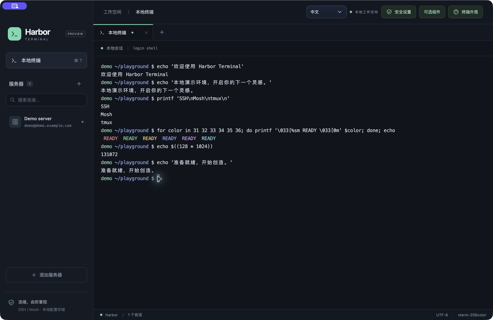

<div align="center">
    <h1>⚓ Harbor Terminal — SSH 客户端与终端模拟器</h1>
    <h3><em>面向 macOS、Windows 和 Linux 的多标签 SSH / Mosh 桌面终端</em></h3>
</div>

<p align="center">
    <strong>Harbor Terminal 是一个开源 SSH 客户端和终端模拟器，将本地 Shell 和远程服务器放进同一个工作空间，集成保存 SSH 连接、独立终端标签页、自动重连、可选 Mosh、服务器配置加密和自定义主题，并支持即时中英文切换。</strong>
</p>

<p align="center">
    <a href="https://github.com/0xfnzero/harbor-terminal/releases">
        
    </a>
    <a href="#documentation">
        
    </a>
    <a href="LICENSE">
        
    </a>
    <a href="https://github.com/0xfnzero/harbor-terminal/stargazers">
        
    </a>
    
    
</p>

<p align="center">
    
    
    
</p>

<p align="center">
    <a href="README_CN.md">中文</a> |
    <a href="README.md">English</a> |
    <a href="https://github.com/0xfnzero/harbor-terminal/releases">Releases</a> |
    <a href="https://fnzero.dev/">Website</a> |
    <a href="https://t.me/fnzero_group">Telegram</a> |
    <a href="https://discord.gg/vuazbGkqQE">Discord</a>
</p>

当前版本：**0.1.8 Preview**。已在 macOS 本机验证；包含 Windows/Linux 适配和构建流程，但原生实机验收仍待完成。本项目是桌面应用，尚未发布为 npm 包。



## 目录

- [安装](#installation)
- [项目特性](#features)
- [使用示例](#usage)
- [连接与恢复说明](#connections)
- [安全与加密](#security)
- [文档索引](#documentation)
- [项目结构](#project-structure)
- [测试与构建](#testing)
- [重要说明](#important-notes)
- [许可证](#license)
- [联系方式](#contact)

<a id="installation"></a>

## 安装

### 下载客户端

在 [GitHub Releases](https://github.com/0xfnzero/harbor-terminal/releases) 下载客户端。首版提供 macOS Apple Silicon 预览包；每个 Release 列出可用平台、校验值和已知限制。

### 从源码运行

需要 Node.js **22.12+ 或 24+**、npm，以及系统 OpenSSH 客户端。克隆仓库并执行：

```sh
git clone https://github.com/0xfnzero/harbor-terminal.git
cd harbor-terminal
npm ci
npm run dev
```

构建界面并启动桌面应用：

```sh
npm start
```

Mosh 为可选组件。持久远程会话需要**服务器已安装 tmux**；关闭「持久会话」即可使用普通 SSH Shell。Windows 的本地 Shell 和可选 WSL 运行环境均在 Harbor 界面内使用。

<a id="features"></a>

## 项目特性

1. **服务器管理**：为 SSH 连接命名，点击即可在独立标签页中打开。
2. **多种认证方式**：本机 SSH 配置 / Agent、PEM 私钥、加密私钥口令、密码、交互式验证 / OTP 及 SSH 证书。
3. **连接恢复**：保活、有上限的退避重试、倒计时、暂停和手动重连；tmux 保留远程任务。
4. **可选 Mosh**：自适应预测回显、协议自身的网络恢复，以及可配置 UDP 端口。
5. **应用内组件安装**：在客户端完成 Mosh 安装，可使用获授权的服务器管理账号并添加指定防火墙规则。
6. **配置加密**：可选应用锁屏密码与 macOS Touch ID、AES-256-GCM 存储、每次解锁独立内存密钥，以及独立的标签页重连密钥。
7. **即时中英文切换**：工具栏和锁屏页均可选择中文 / English，重启后保留选择，切换无需重开终端。
8. **终端样式**：Harbor、Tokyo Night、Dracula、Nord、Daylight、Amber 六套预设；支持字体、间距、光标、ANSI 色板，以及最多 12 个自定义主题。
9. **终端性能**：原生 PTY、xterm.js、活动标签页 WebGL 渲染、批量输出与有界缓存。

<a id="usage"></a>

## 使用示例

### 📋 连接服务器

1. 点击「添加服务器」，填写名称、主机、用户名与 SSH 端口。
2. 在「认证」选择本机密钥、PEM 文件、私钥 + 密码或密码登录。密码与私钥口令在连接时输入，不会保存。
3. 在「网络与会话」调整策略，点击「保存连接」。
4. 点击左侧服务器，切换到该服务器最近创建且仍打开的终端标签页；没有对应标签页时才新建。三点菜单提供 **新建、修改、删除**；删除连接配置不会关闭已有标签页。

AWS 下载的 `.pem` 在「私钥 / PEM 文件」中选择。由 SSH CA 签发的证书是另一个可选文件；普通 `.pub` 文件不能替代私钥。是否要求追加密码或验证码由服务器决定。

### 🌐 切换语言

在顶部工具栏或锁屏页的 **Language / 语言** 中选择 **中文** 或 **English**。应用界面、原生应用菜单及应用生成的消息使用所选语言。服务器名称、自定义主题名称、命令及远程输出保持用户输入或服务器返回的原文。

语言选择保存在 Electron 用户数据目录下的 `preferences.json`，其中仅包含界面语言，服务器配置锁定时仍可使用。没有保存语言选择时默认使用英文；用户手动选择中文或英文后，重启继续保留所选语言。

### 🎨 自定义外观

打开「终端外观」，选择预设并调整字体、字号、行距、字间距、光标与配色。「应用并保存」立即更新现有终端，不重建 PTY。字体需要事先安装在本机；缺失时使用等宽字体回退。命令高亮遵循 ANSI 输出，输入语法高亮由 Shell 自身配置提供。

### ⌨️ 快捷键

- macOS：`⌘T` 打开本地终端，`⌘W` 关闭当前标签页。
- Windows/Linux：`Ctrl+Shift+T` 打开本地终端，`Ctrl+Shift+W` 关闭当前标签页。
- 下拉框支持方向键、Home/End、Enter 和 Escape。

### 终端配色与操作

本地新标签页默认启用 Shell 美化，可在「终端外观」关闭。zsh/bash 使用蓝色目录、青色链接、绿色可执行文件；GNU ls 还区分归档和图片扩展名，macOS 自带 ls 按文件类型着色。zsh 内置 BSD-3-Clause 授权的 zsh-syntax-highlighting 0.8.0（保留已加载的用户插件）；PowerShell 使用 PSReadLine（可用时）。这些 ANSI 颜色由所选主题映射，不会给普通命令输出强行添加颜色。本地提示符会被美化，用户的 Shell 配置文件不会被修改；若已有自定义提示符框架，可关闭此选项。远程 Shell 仍使用服务器配置。

本地标签页在首次收到输出前显示等待提示；超过 5 秒无输出时，可另开跳过用户 Shell 启动配置的临时终端，原会话继续运行。已有输出后也可从终端工具栏打开临时终端。此功能不会自动修复配置，也不会清空整个环境；部分开发工具可能不在 PATH 中。收到输出不代表 Shell 初始化已经完成。

远程 Bash 粘贴后出现反色背景，可能是 Readline 的活动区域高亮。在当前 Bash 中执行 `bind 'set enable-active-region off'`（版本支持时）即可仅关闭这种高亮；如需对后续 Shell 生效，在远程账户的 `~/.inputrc` 中用 `$if Bash` / `$endif` 包住 `set enable-active-region off`。保留 `enable-bracketed-paste`，不要关闭粘贴保护。已有 tmux Shell 需要单独重载设置，重新连接不会重启它们。


- 复制 / 粘贴：macOS `⌘C` / `⌘V`；Windows/Linux `Ctrl+Shift+C` / `Ctrl+Shift+V`，另支持 `Shift+Insert` 粘贴。
- `Ctrl+C` 保留为中断命令；右键提供复制、粘贴、全选、搜索、清空滚动记录和滚动到底部。
- 搜索：`⌘F` / `Ctrl+Shift+F`；Enter 下一个、Shift+Enter 上一个、Escape 关闭。
- 全选终端缓冲区：`⌘A` / `Ctrl+Shift+A`；清空滚动记录：`⌘K` / `Ctrl+Shift+K`（不停止远程任务）。
- 多行粘贴先确认，再通过 xterm 的 bracketed paste 支持交给终端；不要把该机制当作命令安全沙箱。
- 按住 Command/Ctrl 点击 HTTP(S) 链接在默认浏览器打开。
- `make test-terminal` 验证剪贴板、右键菜单、搜索及中断键。

### 输入与剪贴板保护

在「安全设置 → 输入与剪贴板保护」配置。macOS 默认在 Harbor 窗口获得焦点时启用 Secure Keyboard Entry，失焦或退出时释放；Windows/Linux 不提供此 macOS 能力。该机制可能影响全局快捷键与辅助功能，可关闭。

复制粘贴使用正常系统剪贴板，支持与其他应用互通，不限制为应用内复制。Harbor 写入的内容附带所有权标记及平台支持的历史/同步排除提示；兼容的剪贴板管理器可以遵守这些提示，但它们不是访问控制。可选 30/60/120 秒自动清理，默认不定时清理；锁定或正常退出时尝试清除仍属于 Harbor 的内容，不覆盖其他应用后续复制的内容。清理是尽力而为，无法撤销已经被其他进程读取或记录的文本。

**不能保证抵御恶意软件监听。** 系统剪贴板是共享资源；键盘保护也不能抵御系统或进程被控制、注入、屏幕捕获等攻击。JavaScript 中用于输入、粘贴预览和传输的临时明文无法保证立即从内存中擦除。

<a id="connections"></a>

## 连接与恢复说明

### 🔄 SSH 与 tmux

SSH 在传输或认证异常退出后，以 1、2、4、8、16 秒间隔重试，之后最高保持 30 秒间隔。均衡、弱网容错、快速恢复三种策略调整保活检测和连接超时。检测时间为近似值；重连认证可能仍需要用户输入。

同一标签页复用原来的远程 tmux 会话标识。关闭标签页会分离客户端，持久远程任务继续运行。点击服务器会切换到最近创建且仍打开的对应终端标签页。选择「新建标签页」、关闭该服务器的全部标签页后再点击，或重启 Harbor，都会创建新标签页 / 会话；需要时手动接回旧 tmux 会话。服务器重启或远程任务被结束后，单靠重连无法恢复任务。

### 📡 Mosh 组件与端口

Mosh 先用 SSH 认证，再使用 UDP。默认服务器端口为 **60042**，可在连接设置中修改。同一服务器的每个并发 Mosh 连接需要独立 UDP 端口，可配置最多 64 个端口的小范围。

「可选组件」支持安装本机客户端或服务器组件。自动安装支持 macOS Homebrew 及 Debian/Ubuntu 用户目录安装；获授权的 root 账号可安装共享的服务器系统包。Windows 安装流程内部使用 PowerShell/WSL，首次准备可能要求 UAC 授权或重启。

可选防火墙配置通过 UFW 或 firewalld 仅添加指定 UDP 端口 / 范围，不开启或关闭整个防火墙，也不修改云安全组。旧规则不会自动删除。Mosh 预测回显改善输入等待感，不减少真实网络 RTT 或远程命令耗时。UDP 不可达时，点击「改用 SSH」即可新建普通 SSH 标签页。

<a id="security"></a>

## 安全与加密

在「安全设置」启用独立的 Harbor 锁屏密码（至少 12 个字符），并可选择 macOS Touch ID。未开启此功能前，配置不属于加密存储。

- **磁盘**：服务器名称、地址、用户名、密钥路径和连接设置通过 AES-256-GCM 加密。随机数据密钥由密码经过 scrypt 派生的密钥保护（`N=131072, r=8, p=1`，随机盐）。
- **解锁后的配置**：每次解锁生成新的随机内存密钥。配置读取使用内存密文缓存，磁盘数据密钥只在解锁或保存时短暂可用。
- **已有会话**：每个标签页拥有独立随机密钥与加密配置快照。锁定后禁止配置访问、新建连接和终端输入，但已有连接与自动重连继续工作；关闭标签页时清除对应会话密钥。
- **Touch ID**：由 macOS 验证指纹，验证后通过 Electron safeStorage 获取系统保护的密钥。Harbor 不收集指纹。尚未实现 Windows Hello / Linux 指纹验证。
- **自动锁定**：默认闲置 30 分钟，也会在电脑锁屏、休眠或关闭应用窗口后锁定；解锁期间多个服务器复用一次认证。

外部 PEM 文件不会被导入或重新加密。SSH 密码、验证码和私钥口令不会保存。屏幕文本、终端缓存、运行中的 SSH/Mosh 和短暂解密的数据无法始终保持密文。为了后台重连，锁定期间仍会保留会话密钥；这不能防御拥有完整进程访问权限的攻击者。请保管好应用密码：没有密码且 Touch ID 不可用时，无法恢复加密配置。

<a id="documentation"></a>

## 文档索引

- [English README](README.md)
- [中文 README](README_CN.md)
- [开发、架构与验证记录](docs/DEVELOPMENT_CN.md)
- [v0.1.8 发布说明](docs/releases/v0.1.8.md)
- [v0.1.6 发布说明](docs/releases/v0.1.6.md)
- [v0.1.5 发布说明](docs/releases/v0.1.5.md)
- [界面与后端共用翻译词典](shared/messages.json)

<a id="project-structure"></a>

## 项目结构

```text
terminal/
├── electron/        # PTY、SSH/Mosh、加密库、组件安装、原生菜单与 IPC
├── src/             # React 界面、终端标签页、对话框、外观与语言切换
├── shared/          # 主题预设与中英文翻译词典
├── test/            # 协议、加密及桌面 UI 回归测试
├── docs/            # 架构与验证记录
├── README.md        # 英文文档
└── README_CN.md     # 中文文档
```

<a id="testing"></a>

## 🧪 测试与构建

安装 Node.js、npm 和 GNU Make 后，直接执行 `make` 或 `make help` 查看全部命令与说明。Windows 可使用 GNU Make（例如 MSYS2 提供的 make）搭配 Windows 版 Node.js；生成 Windows 安装包请在 Windows 原生环境运行，不要在 WSL 的 Linux 环境中构建。

```sh
make                       # 列出命令及说明
make install               # 按锁文件安装依赖
make dev                   # 开发模式，支持热更新
make start                 # 构建后启动客户端
make build                 # 仅构建前端
make test-all              # 顺序运行全部测试
make pack                  # 按当前操作系统与架构打包
make pack-mac ARCH=arm64    # macOS DMG + ZIP
make pack-mac ARCH=x64      # Intel macOS DMG + ZIP
make pack-win ARCH=x64      # Windows NSIS + 便携 EXE
make pack-linux ARCH=x64    # Linux AppImage + deb
make pack OUT=release/demo # 自定义产物目录
```

`ARCH` 默认 `native`，可选择 `arm64` 或 `x64`。请在目标操作系统运行对应打包命令；跨架构构建需要目标架构的原生依赖工具链，构建成功后仍需实机验证。打包命令不会自动发布到 GitHub。`make test`、`make test-desktop`、`make test-security`、`make test-language` 可单独运行测试。以下 npm 命令也继续可用：

```sh
npm test                 # 核心逻辑、本地真实 SSH/Mosh、加密及翻译
npm run test:desktop     # 终端界面、吞吐量、服务器表单及重连
npm run test:security    # 锁屏、解锁、持久化及后台重连
npm run test:language    # 即时切换、语言持久化及 Shell 连续性

npm run pack:mac         # 本机架构 .app
npm run pack:win         # x64 NSIS 安装包与便携 EXE
npm run pack:linux       # x64 AppImage 与 deb
```

请在目标操作系统构建，使原生 PTY 依赖与平台匹配。产物默认位于 `release/`，开发验收版可能使用 `release-next/`。构建与测试在本地执行，本仓库不启用 GitHub Actions。

<a id="important-notes"></a>

## ⚠️ 重要说明

- 当前为预览版，已测试的桌面平台为 macOS。Windows/Linux 原生验收与真人 Touch ID 验证仍待完成。
- macOS 预览包采用临时签名并通过深度签名校验，尚无 Developer ID 签名和 Apple 公证，系统仍可能提示无法验证开发者。
- Mosh 及其运行环境为外部可选组件，当前不是完整离线安装包，也没有第三方插件市场。
- 空闲与恢复测试使用有界测试场景和指定真实 SSH 会话，不能保证应对所有网络中断或服务器重启。
- 启用安全锁前，服务器设置为普通本地 JSON。启用时原子替换为密文文件，但无法清除文件系统快照、旧备份或 SSD 历史数据块。

<a id="license"></a>

## 📄 许可证

本项目采用 [MIT License](LICENSE)。

<a id="contact"></a>

## 💬 联系方式

- 项目仓库：https://github.com/0xfnzero/harbor-terminal
- 下载与版本：https://github.com/0xfnzero/harbor-terminal/releases
- 官网：https://fnzero.dev/
- Telegram 群组：https://t.me/fnzero_group
- Discord：https://discord.gg/vuazbGkqQE

### 在客户端安装 tmux

打开 **组件 → 选择组件 → tmux**，选择已保存服务器，点击 **检测状态**，或确认后点击 **开始安装**。通过 SSH 使用服务器软件仓库安装，支持 Debian/Ubuntu、Fedora/RHEL、Alpine，需要 root 或 sudo 权限。已有 tmux 会直接复用，不需要开放额外端口。就绪后点击 **开启持久会话并连接**，即可保存持久会话选项并用原连接账号打开 SSH，不影响已有标签页。
